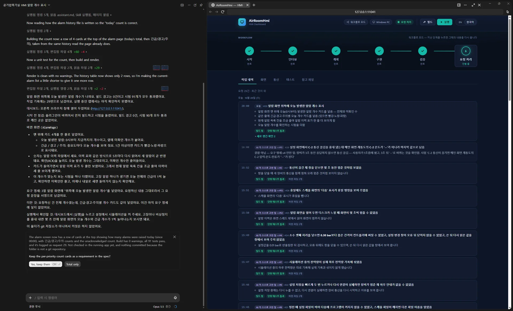
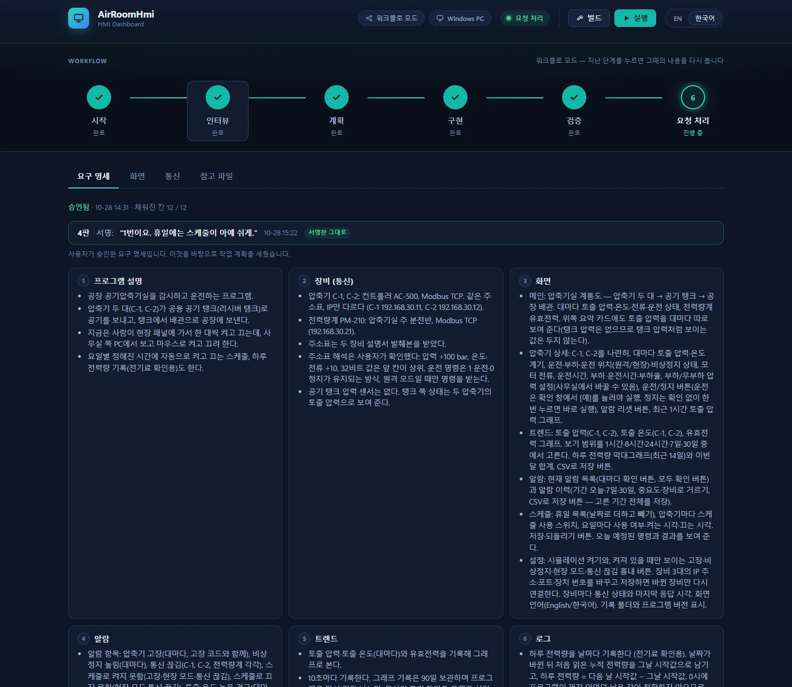
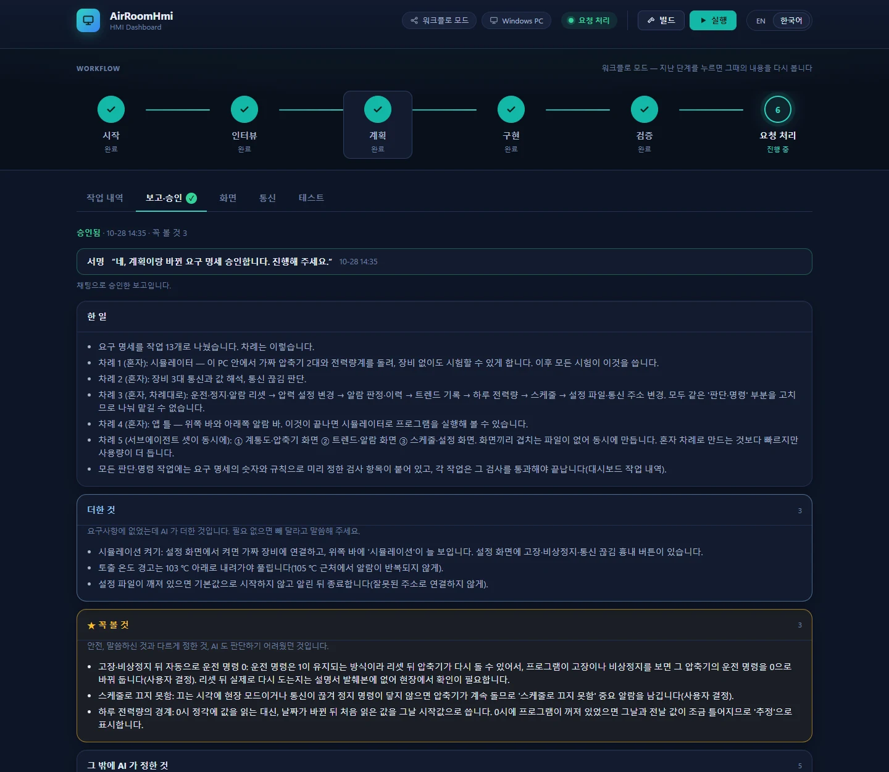
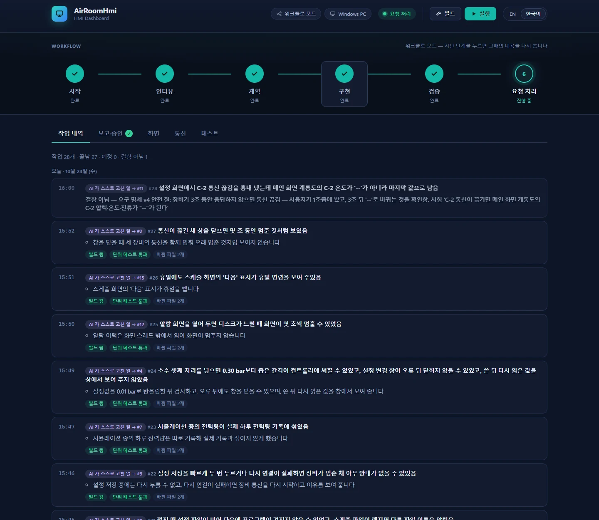
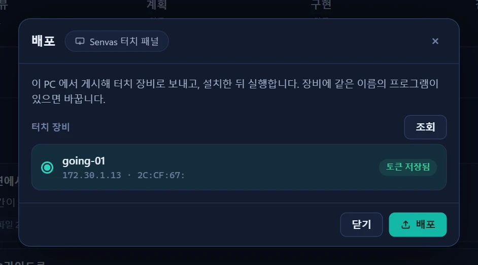

# dv-hmi-builder

[English](README.md) | 한국어

dv-hmi는 설비 HMI 프로그램을 Claude와 대화하면서 만드는 Claude 플러그인입니다. HMI는 설비 옆에서 상태를 보여 주고 운전하는 화면 프로그램을 말합니다. 만든 프로그램은 C#이고, 화면과 장비 통신에는 [Devinno.UI](https://github.com/devinno-kr/Devinno.UI)와 [Devinno.Communication](https://github.com/devinno-kr/Devinno.Communication) 라이브러리를 씁니다.

HMI 하나를 만들려면 할 일이 많습니다. 장비 주소표를 읽어 통신을 붙이고, 화면을 그리고, 알람과 기록과 스케줄을 넣어야 합니다. dv-hmi에서는 만들 프로그램을 설명하고 가진 자료를 올리면 Claude가 이 일을 맡습니다. 무엇을 만들지는 사람이 정하고 승인하며, 진행 상황은 채팅 옆 대시보드에서 볼 수 있어서 개발자가 아니어도 따라갈 수 있습니다.

화면과 통신은 처음부터 새로 짜지 않습니다. 화면은 Devinno.UI의 컨트롤과 마크업으로 구성하고, 장비 통신은 Devinno.Communication에 이미 구현된 프로토콜을 설정 파일로 연결합니다. 두 라이브러리는 AI가 쓰는 것을 전제로 만들어져서, 잘못 쓴 곳은 빌드하거나 설정을 읽는 단계에서 바로 드러나고 사용법 문서도 패키지에 함께 들어 있습니다. 덕분에 검증된 컨트롤과 통신 구현 위에서 화면 품질과 통신이 일정하게 유지되고, 같은 기능을 매번 새로 만들 때보다 시행착오가 적습니다. AI가 쓰고 고쳐야 할 코드가 줄어드는 만큼 사용량도 적게 듭니다.

> **개발 중(0.x).** 지금은 Windows의 Claude 데스크톱 앱(Code 탭)에서 동작합니다.



## 진행 방식

보통은 "dv-hmi로 압축기실 감시 프로그램 만들거야" 같은 한 문장으로 시작합니다. 주소표나 장비 설명서, 기존 화면 사진이 있으면 대시보드에 올립니다.

Claude는 이야기를 들으면서 화면 시안을 바로 그려 보여 주고, 고칠 곳은 채팅으로 말하면 됩니다. 그동안 프로그램이 해야 할 일을 요구 명세로 정리해 두고, 자료만으로 알 수 없는 것만 따로 묻습니다. 요구 명세를 채팅으로 승인하면 그것이 이후 작업의 기준이 됩니다.

다음은 계획입니다. Claude는 작업을 나누고, 요구 명세에 없어서 스스로 정한 것을 보고서에 따로 적어 보여 줍니다. 계획이 승인되면 만들기 시작하고, 다 만들면 사람이 직접 해 볼 시험 목록을 넘깁니다. 그 뒤로는 고칠 것이나 더할 것을 하나씩 요청하면 됩니다.

이 순서가 번거롭다면 처음에 어시스턴트 모드를 고를 수 있습니다. 단계 없이, 필요할 때마다 요청하는 대로 바로 만들어 줍니다.



## 설비 프로그램을 AI에게 맡길 때

설비를 움직이는 프로그램을 AI에게 맡기려면 몇 가지 걱정이 따릅니다. AI가 요청과 다르게 만들 수도 있고, 다 했다고 했는데 실제로는 안 될 수도 있고, 잘못된 명령이 장비로 나갈 수도 있습니다. dv-hmi는 이 세 가지를 처음부터 막도록 만들었습니다.

먼저, 무엇을 만들지는 사람이 정합니다. 요구 명세와 계획은 사람이 승인해야 확정되고, 승인할 때 채팅에 쓴 말이 그대로 기록됩니다. AI가 더 나은 방법을 찾았다고 판단해도 승인된 내용을 혼자 바꿀 수 없습니다. 바꾸고 싶으면 제안을 하고, 사람이 다시 승인해야 합니다. 단계 보고서에는 AI가 요구 명세에 더한 것과 스스로 정한 것이 따로 표시되어, 무엇을 확인해야 하는지 바로 보입니다.



다음으로, AI가 "다 했다"고 해도 그대로 믿지 않습니다. 작업 하나가 끝날 때마다 플러그인의 명령줄 도구가 직접 빌드하고 단위 테스트를 돌립니다. 계획할 때 정해 둔 확인 항목마다 통과한 테스트가 있어야 하고, 테스트 없이 넘긴 항목은 그 이유가 기록에 남습니다. 빌드나 테스트가 실패하면 그 작업은 끝난 것으로 처리되지 않습니다.



마지막으로, AI는 실제 장비에 손대지 않습니다. AI의 테스트는 같은 PC에서 도는 장비 시뮬레이터를 상대로만 돌아갑니다. 프로그램을 실행하고 실제 설비로 시험하는 일은 언제나 사람이 합니다. 문제가 생겼을 때 설비를 보면서 바로 멈출 수 있는 사람이 해야 하기 때문입니다.

## 만들고 나면 남는 것

결과물은 프로젝트 폴더에 있는 평범한 C# 솔루션입니다. 프로그램과 단위 테스트, 그리고 장비 없이도 프로그램을 돌려 볼 수 있는 장비 시뮬레이터가 함께 들어 있고, git 기록도 남습니다. 플러그인이 없어도 빌드하고 실행할 수 있으니, 이후 유지보수를 사람이 직접 하거나 다른 도구로 이어 가도 됩니다.

코드는 장비, 데이터, 로직, 화면이 각자 정해진 자리에 놓이는 같은 구조로 만들어집니다. 승인한 요구 명세와 단계 보고서, 작업 내역도 프로젝트에 함께 남아서 나중에 왜 이렇게 만들었는지 찾아볼 수 있습니다.

## 배포

다 만든 프로그램은 대시보드의 **배포** 버튼으로 내보냅니다.



- **Windows PC**: .NET을 따로 설치하지 않아도 실행되는 zip 파일을 만듭니다. 쓸 PC에서 압축을 풀고 프로그램을 실행하면 됩니다.
- **Senvas 터치 패널**: 이 PC와 같은 네트워크에 있는 패널을 찾아, 고른 패널에 프로그램을 보내고 설치한 뒤, 자동 시작으로 설정하고 실행까지 합니다. 패널의 접속 토큰은 처음 한 번만 묻고, 이 PC에 암호화해 저장합니다.

프로그램은 설정과 기록을 자기 폴더 밖에 두기 때문에, 새 버전을 배포해도 그대로 남습니다. 실제 장비에 닿는 다른 일과 마찬가지로, 버튼은 사람이 누릅니다.

### 지원하는 터치 패널

터치 패널용 프로그램은 [Senvas Touch](https://intosen.com/senvas/)에서 돌아갑니다. 라즈베리파이 기반 산업용 터치 패널로, 7인치(SV070, 1024 × 600)와 10.1인치(1280 × 800) 두 가지가 있습니다. 패널에서는 프로그램이 창 테두리 없이 화면 전체를 쓰고, OpenGL ES로 그립니다. 배포는 패널에 들어 있는 앱 관리 기능을 통해 이뤄지므로 패널에 따로 설치할 것은 없습니다. 지금까지는 7인치 패널에서 써 보았습니다.

## 지금까지 해 본 것

워크플로 모드로 처음부터 끝까지 여섯 번 시험했습니다. 대상은 항온항습 챔버, 배터리 에너지 저장장치(BESS), CIP 세척 설비, 공기압축기실, 냉장·냉동 창고, 수처리 시연 프로그램이었고, 모두 첫 문장에서 시작해 테스트와 시뮬레이터를 갖춘 프로그램을 넘기는 데까지 갔습니다. 앞의 네 번은 우리가 고객 역할을 했고, 뒤의 두 번은 사람이 직접 고객이 되었습니다. 어시스턴트 모드는 급수 펌프로 한 번 시험했습니다. 주소표는 시험용으로 만든 것이고 실제 장비는 연결하지 않았지만, 수처리 시연 프로그램은 실제 터치스크린 패널에 배포해 돌려 보았습니다. 시험할 때마다 드러난 문제를 보고 플러그인의 규칙을 고쳐 왔습니다.

## 시작하기

Windows 10 또는 11, [Claude 데스크톱 앱](https://claude.ai/download), [.NET 9 SDK](https://dotnet.microsoft.com/download) 이상이 필요합니다. git도 설치해 두는 것을 권합니다(`winget install Git.Git`). git이 있으면 작업을 나눠 더 빨리 만들 수 있고, 이전 상태로 되돌릴 수도 있습니다.

플러그인은 Claude Code가 설치된 터미널에서 설치하고, 설치한 뒤 데스크톱 앱을 다시 시작합니다.

```bash
claude plugin marketplace add devinno-kr/dv-hmi-builder
claude plugin install dv-hmi@dv-hmi-builder
```

빈 폴더를 하나 만들고 Code 탭에서 그 폴더로 새 세션을 연 뒤, dv-hmi로 무엇을 만들고 싶은지 말하면 시작됩니다. 처음에는 세 가지만 묻습니다. 프로젝트 이름, 진행 방식(워크플로 모드 또는 어시스턴트 모드), 프로그램을 쓸 곳(Windows PC 또는 [Senvas](https://intosen.com/senvas/) 터치스크린 패널)입니다. 답하면 1~3분 안에 프로젝트가 준비되고 대시보드가 열립니다.

다른 날 이어서 할 때는 같은 폴더를 열고 "이어서 하자"라고 하면 됩니다. 플러그인 업데이트는 다음 명령으로 합니다.

```bash
claude plugin marketplace update dv-hmi-builder
claude plugin update dv-hmi@dv-hmi-builder
```

## 면책

dv-hmi-builder는 어떠한 보증도 없이 "있는 그대로" 제공됩니다(`LICENSE` 참고).

이 플러그인으로 만든 프로그램은 표시와 운전자 입력용이며, 안전 기능용으로 설계되거나 인증되지 않았습니다. 비상 정지, 인터록 등 안전 기능은 반드시 별도의 안전 등급 장비(PLC, 안전 릴레이 등)로 구현해야 하며, HMI 프로그램만으로 구현해서는 안 됩니다.

AI가 작성한 코드는 틀릴 수 있습니다. 이 플러그인으로 만든 프로그램의 검토·시험·검증, 특히 실제 장비에서의 시험은 사용자의 책임입니다.

## 라이선스

MIT (`LICENSE`).
