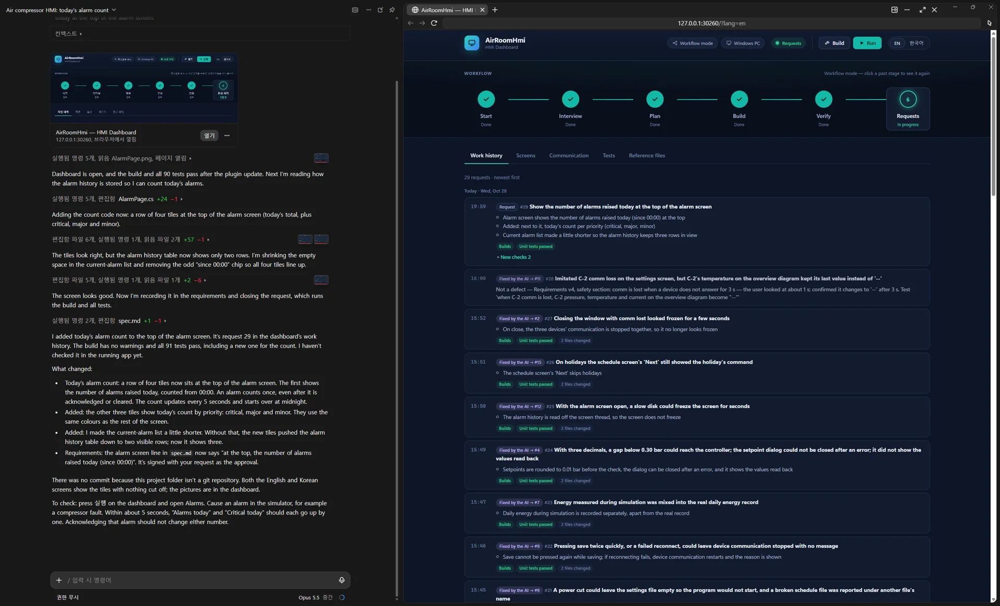
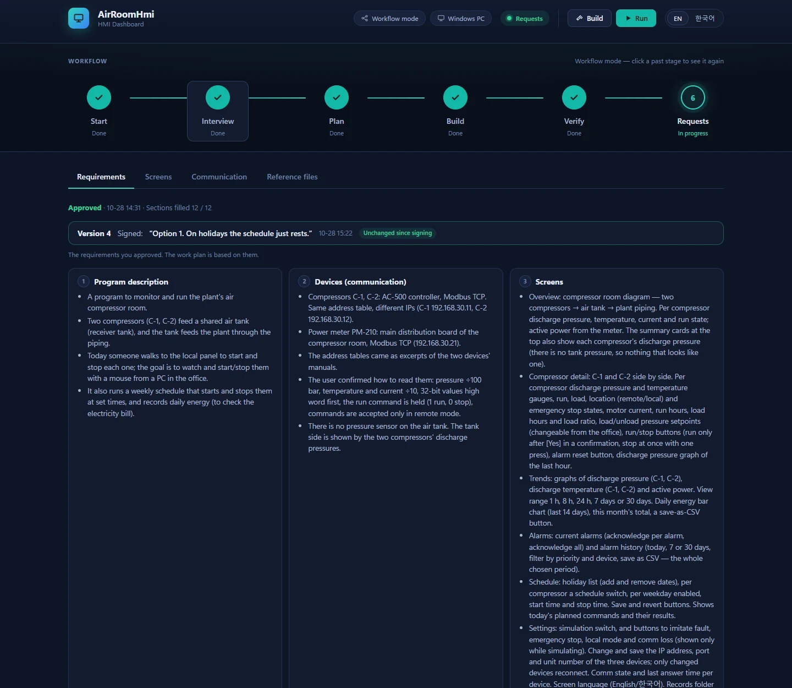
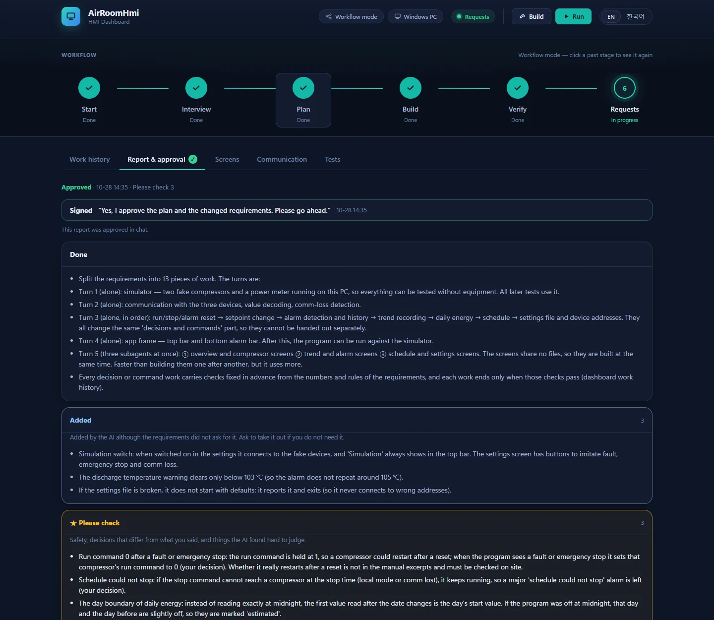
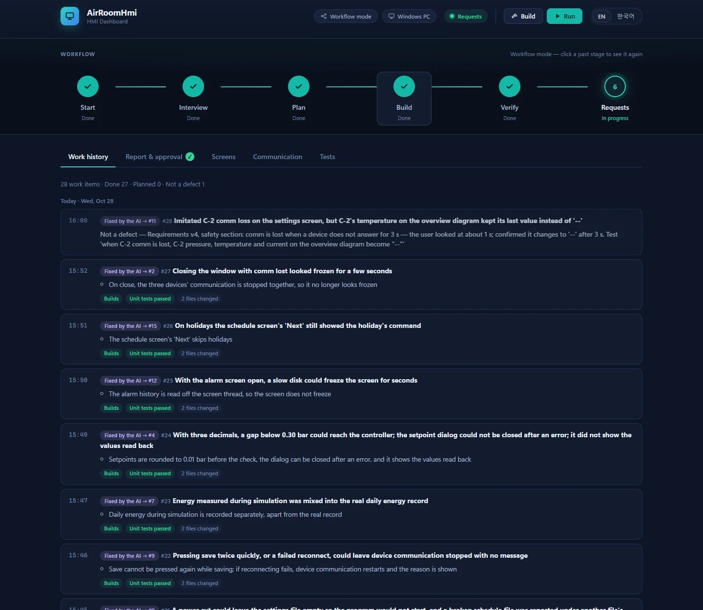
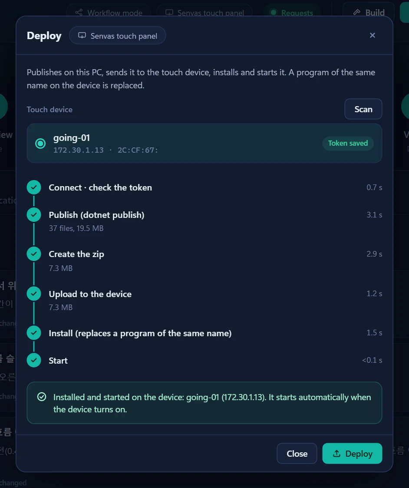

# dv-hmi-builder

English | [한국어](https://github.com/devinno-kr/dv-hmi-builder/blob/main/README.ko.md)

dv-hmi is a Claude plugin for building equipment HMI programs by talking with Claude. An HMI is the screen program next to a machine that shows its state and lets an operator run it. The programs are written in C#, and their screens and device communication use the [Devinno.UI](https://github.com/devinno-kr/Devinno.UI) and [Devinno.Communication](https://github.com/devinno-kr/Devinno.Communication) libraries.

Building an HMI involves a lot of work. Someone has to read the device address tables and set up the communication, draw the screens, and add alarms, records and schedules. With dv-hmi you describe the program and upload the material you have, and Claude does that work. People still decide what gets built and approve it, and the progress is shown on a dashboard next to the chat, so you can follow along without being a developer.

The screens and the communication are not written from scratch. Screens are put together from Devinno.UI controls and markup, and device communication connects to protocols already implemented in Devinno.Communication through a settings file. Both libraries were built on the assumption that an AI writes the code, so mistakes show up as soon as the program is built or the settings are loaded, and the usage docs ship inside the packages. Building on tested controls and protocol implementations keeps the screens and communication at a steady level of quality and means less trial and error than writing the same features anew each time. Because the AI has less code to write and fix, it also uses less.

> **Under development (0.x).** It currently runs in the Claude desktop app (Code tab) on Windows.



## How it works

A project usually starts with a single sentence, such as "Build me a monitoring program for our compressor room with dv-hmi." Address tables, device manuals or photos of existing screens can be uploaded on the dashboard.

While listening, Claude draws drafts of the screens right away, and changes are asked for in chat. Meanwhile it writes down what the program has to do as a set of requirements, and only asks about the things the material cannot answer. Once the requirements are approved in chat, they become the basis for all the work that follows.

Next comes the plan. Claude splits the work into pieces and writes a report that lists separately what it decided on its own because the requirements did not say. After the plan is approved, it builds the program and then hands over a list of tests for a person to try. From there, fixes and additions are requested one at a time.

If that sequence feels like too much, assistant mode can be chosen at the start. It has no stages: Claude builds whatever is asked for, whenever it is asked.



## Handing equipment software to an AI

Letting an AI build software that runs equipment raises a few worries. The AI might build something other than what was asked for, it might say it is finished when it is not, or a wrong command might reach the machine. dv-hmi was designed from the start to guard against all three.

First, people decide what gets built. The requirements and the plan are fixed only when a person approves them, and the words written in chat to approve them are recorded as they were. Even if the AI decides there is a better way, it cannot change approved content on its own. It can propose the change, and a person has to approve it again. Stage reports mark separately what the AI added to the requirements and what it decided by itself, so it is clear what needs checking.



Second, an AI saying "done" is not taken at its word. Each time a piece of work is finished, the plugin's command-line tool builds the program and runs the unit tests itself. Every check planned for that work needs a passing test, and any check passed without a test has its reason recorded. If the build or a test fails, the work is not treated as finished.



Third, the AI does not touch real equipment. Its tests run only against a device simulator on the same PC. Starting the program and testing it on the actual machine is always done by a person, because it should be someone who can watch the machine and stop it at once if something goes wrong.

## What you are left with

The result is an ordinary C# solution in the project folder. It contains the program, its unit tests and a simulator of the devices, so the program can be run without any equipment, and it keeps a git history. It builds and runs without the plugin, so maintenance can later be done by hand or continued with other tools.

The code always follows the same structure, with devices, data, logic and screens each in their own place. The approved requirements, the stage reports and the work history stay in the project as well, so it is possible to look up later why something was built the way it was.

## Deploying

The **Deploy** button on the dashboard ships the finished program.



- **Windows PC**: it makes a zip that runs without installing .NET. Unzip it on the target PC and start the program.
- **Senvas touch panel**: it finds the panels on the same network as this PC, then sends the program to the chosen one, installs it, sets it to start automatically and starts it. The panel's access token is asked once and kept encrypted on this PC.

The program keeps its settings and records outside its own folder, so they survive when a new version is deployed. Pressing the button is up to a person, like every other step that reaches real equipment.

### Supported touch panels

Touch panel programs run on [Senvas Touch](https://intosen.com/en/senvas/), a Raspberry Pi based industrial touch panel that comes in 7-inch (SV070, 1024 × 600) and 10.1-inch (1280 × 800) sizes. On the panel the program fills the screen without a window border and draws with OpenGL ES. Deployment goes through the app manager the panel comes with, so nothing else has to be installed on it. So far it has been tried on the 7-inch panel.

## What has been tried so far

Workflow mode has been tested end to end six times: on a climate test chamber, a battery energy storage system (BESS), a CIP cleaning plant, an air compressor room, a cold storage warehouse and a water treatment demo. Each run went from the first sentence to a delivered program with tests and a simulator. In the first four we played the customer; in the last two a person did. Assistant mode was tested once, on a feed water pump. The address tables were made up for the tests and no real equipment was connected, but the water treatment demo was deployed to a real touchscreen panel and run there. After each run we changed the plugin's rules based on the problems that came up.

## Getting started

You need Windows 10 or 11, the [Claude desktop app](https://claude.ai/download) and the [.NET 9 SDK](https://dotnet.microsoft.com/download) or later. Installing git is also recommended (`winget install Git.Git`): with it, the work can be split up to go faster, and earlier states can be restored.

The plugin is installed from a terminal where Claude Code is installed. Restart the desktop app afterwards.

```bash
claude plugin marketplace add devinno-kr/dv-hmi-builder
claude plugin install dv-hmi@dv-hmi-builder
```

To start, create an empty folder, open it in a new session in the Code tab, and say what you want to build with dv-hmi. At first only three things are asked: the project name, how to proceed (workflow or assistant mode), and where the program will run (Windows PC or [Senvas](https://intosen.com/en/senvas/) touchscreen panel). After that, the project is ready in 1 to 3 minutes and the dashboard opens.

To continue on another day, open the same folder and say "continue". The plugin is updated with:

```bash
claude plugin marketplace update dv-hmi-builder
claude plugin update dv-hmi@dv-hmi-builder
```

## Disclaimer

dv-hmi-builder is provided "as is", without warranty of any kind (see `LICENSE`).

Programs built with it are for display and operator input, and they are not designed or certified for safety functions. Emergency stops, interlocks and other safety functions must be implemented in separate safety-rated equipment (PLC, safety relays, etc.), never in the HMI program alone.

Code written by AI can be wrong. You are responsible for reviewing, testing and validating any program you build with it, especially against real equipment.

## License

MIT (`LICENSE`).
